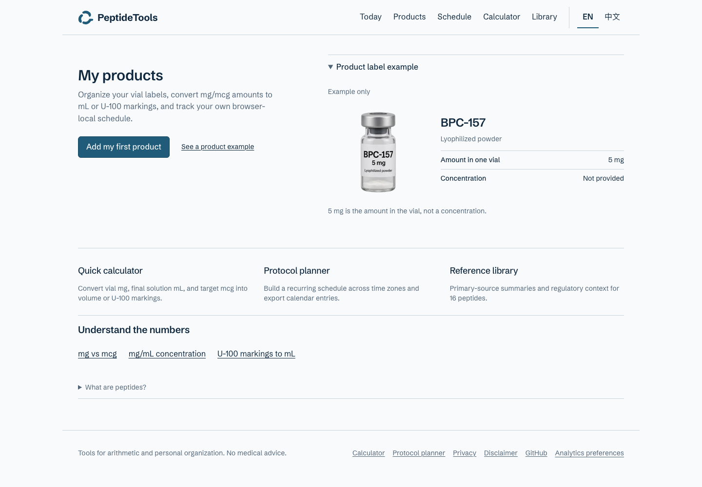

# Peptide Tools

[English](README.md) | [简体中文](README.zh-CN.md)

A browser-local workspace for organizing peptide product labels, checking mass-to-volume arithmetic, and keeping personal schedules and actual-use records. English by default, with a Chinese interface.

**[Open the website](https://peptides.ybwdaisy.com)** · [Calculator](https://peptides.ybwdaisy.com/calculator) · [Reference library](https://peptides.ybwdaisy.com/library)



Arithmetic and personal organization only. The tool does not select a dose, verify product safety or provide medical advice. See the [disclaimer](https://peptides.ybwdaisy.com/disclaimer).

## What you can do

| Tool | What it does |
| --- | --- |
| [My products](https://peptides.ybwdaisy.com/products) | Record your own labels, including single ingredients and blends. Unknown information stays unknown; a product name never supplies missing concentration or dose information. |
| [Calculator](https://peptides.ybwdaisy.com/calculator) | Convert a user-specified mg/mcg amount and mg/mL concentration to mL. Alternatively, enter vial mass and confirmed final solution volume. Save calculations and reopen them for review. |
| U-100 scale | Optionally show a volume reading for an explicitly selected scale, capacity and graduation. Markings are not peptide activity in IU; results are not rounded to a usable injection. |
| [Schedule](https://peptides.ybwdaisy.com/planner) | Enter dates, time zone and daily, alternate-day, weekday or every-N-day rules. Generate a calendar, save locally, print or export `.ics`. |
| [Today](https://peptides.ybwdaisy.com/today) | See entries across saved schedules, explicitly record taken/skipped entries, edit or backfill history, and export CSV. Planned entries are not automatically recorded as taken. |
| [Reference library](https://peptides.ybwdaisy.com/library) | Browse 16 source-linked entries with study context, evidence limitations and unknowns. Research summaries are not dosing templates. |
| Backup and restore | Download versioned JSON, preview a validated backup and confirm before replacing local records. |

There are no accounts, cloud sync, delivered reminders, default peptide combinations or AI dose recommendations.

## Start using it

1. [Add a product](https://peptides.ybwdaisy.com/products/new) from its actual label. Leave uncertain information unfilled.
2. Open its calculation or use the standalone calculator. Supply your own specified amount and confirmed concentration inputs.
3. Create a schedule with your own dates, times and repeat rules, then generate and save it.
4. Use **Today** to record what actually happened, separately from the plan.
5. Download a JSON backup before clearing browser data or moving to another browser/device. Use JSON to restore the workspace; calendar and CSV exports serve different purposes.

## Local data and privacy

Products, calculations, schedules and actual records stay in this browser's `localStorage`, without a business backend. Clearing site data, changing browser/profile or switching domains can make records unavailable. The Vercel alias and official domain have separate storage.

JSON restoration replaces the workspace only after validation, preview and confirmation. Backups read versions 1–4; actual history uses version 4. The storage key remains `peptide-tools.protocols.v1`. Saved calculations reopen without automatically calculating, and changed linked products require review. The displayed download-request time is not proof that a file was saved. Exported files contain your own entries.

Saving requires Web Locks support over HTTPS or localhost. Unsupported browsers cannot save safely; existing data can still be exported. Writes are serialized, and actual records retain snapshots independently of later product/plan edits. Current limits include 20 schedules, 20 items per schedule, 366 days per cycle, 10,000 actual records and 10 MB imports; browser storage quota also applies.

Optional GA4 analytics loads only after consent on the approved production origin. Inputs, product names, notes, search terms and specific reference identities are excluded. Rejecting analytics leaves the tools usable. See [Privacy](https://peptides.ybwdaisy.com/privacy).

## Run locally

Requires **Node.js 24.x** and npm. Local use needs no account, database or analytics ID.

```sh
git clone https://github.com/ybwdaisy/peptide-tools.git
cd peptide-tools
npm ci
ASTRO_TELEMETRY_DISABLED=1 npm run dev
```

Open Astro's printed URL, normally `http://127.0.0.1:4321`. In agent environments Astro may keep a background server; use `npx astro dev status` / `npx astro dev stop` to inspect or stop that server.

## Verify changes

```sh
npm run check
npm test
npm run verify:funnels
npm run verify:funnels:remote
ASTRO_TELEMETRY_DISABLED=1 npm run build
npm run verify:site
npm run verify:seo
npx playwright install --with-deps chromium webkit
npm run test:e2e
```

The remote funnel check needs network access and compares the public contract with its cache; it does not execute remote JavaScript. Build/SEO checks do not submit IndexNow notifications.

Browser tests use the built preview, not the development server. Stop a dev server occupying port 4321 first. Local desktop tests use installed Google Chrome; CI uses Playwright Chromium. Without Chrome, run `CI=1 npm run test:e2e` with the port free to use downloaded Chromium. The mobile project is iPhone 13 WebKit emulation, not a physical-device test.

For another preview port, set `PLAYWRIGHT_BASE_URL` to that preview's actual URL. Astro's `preview status` / `preview stop` commands help identify a background preview. Do not stop an unrelated project's server.

Coverage includes exact conversions, invalid inputs/capacity, leap days and DST, recurrence, cross-plan records, concurrent writes, backup compatibility, exports, language switching and analytics isolation.

## Architecture and deployment

**Astro + TypeScript**, with statically built pages and browser-side tools. `decimal.js` handles decimal arithmetic; `@js-temporal/polyfill` handles dates and time zones. Fonts, icons and the educational label image are local assets. There is no business API, user database or authentication service.

```text
src/pages/          Routes and localized pages
src/components/     Shared forms and controls
src/scripts/        Browser interactions
src/lib/            Arithmetic, schedules, records, storage and validation
src/data/           Source-linked reference content
src/i18n/           Chinese translations
analytics/          Funnel source and cached public contract
seo/                IndexNow release list and maintenance guidance
public/             Local assets and generated public manifest
scripts/            Build and verification commands
tests/              Unit and browser regressions
```

The official deployment is **https://peptides.ybwdaisy.com**. Vercel builds `main` with Node 24, `npm run build` and output directory `dist`. Local/preview origins do not collect into production GA4; preview builds are noindex.

Optional public identifiers are in [`.env.example`](.env.example). A fork runs locally as-is. Deployment to another hostname requires reviewing Astro's site URL, canonical/sitemap/robots output, the analytics origin gate, funnel hostname validation and IndexNow together; changing only `astro.config.mjs` is insufficient.

Production manual QA must enter with `?analytics_test=1` (or `?qa=1`). Automated production visits must also intercept the SDK and all collection transports **before navigation**. Test normal-visitor events only in the intercepted offline fixture; never send synthetic events to real GA4.

## Contributing and maintenance

Open a focused [issue](https://github.com/ybwdaisy/peptide-tools/issues) or pull request, explaining the scenario and verification performed. Preserve backup compatibility, saved snapshots, explicit restore/clear confirmations, unit meanings and privacy boundaries. New reference facts need primary sources and explicit evidence limitations.

Never commit credentials, `.env` files, browser profiles, real-user backups or traces containing private data. The `private: true` package flag prevents accidental npm publication; it does not make this GitHub repository private.

- [Funnel source and public contract](analytics/README.md)
- [SEO checks and explicit IndexNow release command](seo/README.md)
- [Daily records, time zones and v4-aware rollback](docs/daily-workflow-2026-11-17.md)
- [Calculation/backup workflow validation](qa/label-workflow-validation.md)
- [Project instructions](AGENTS.md)

Older release evidence in `docs/` and `qa/` describes its dated release, not the latest deployment status. Use current source and CI for new changes.

## License

Original project source is available under the [MIT License](LICENSE). Bundled fonts retain their own SIL Open Font License notices: [Schibsted Grotesk](public/fonts/schibsted-grotesk-LICENSE.txt), [IBM Plex Sans](public/fonts/OFL-IBM-Plex-Sans.txt), and the [font embedded in the wordmark](public/brand/FONT-LICENSE.txt).
