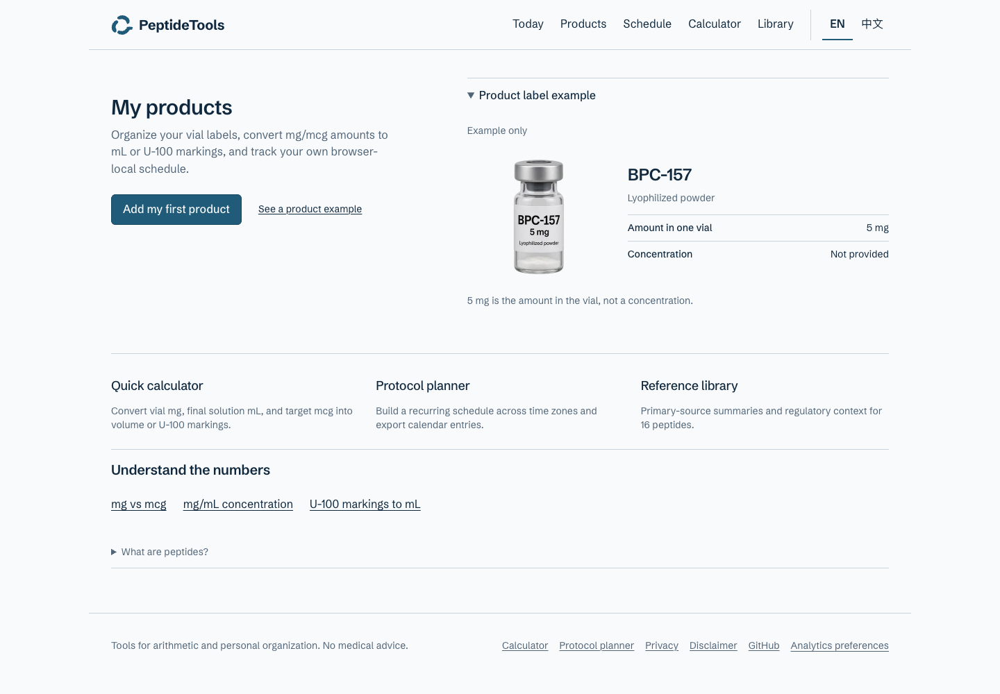

# Peptide Tools

[English](README.md) | [简体中文](README.zh-CN.md)

在浏览器本地记录肽类产品标签、核对质量与体积换算、管理个人计划和实际记录。默认英文，支持切换中文。

**[打开网站](https://peptides.ybwdaisy.com/zh)** · [计算器](https://peptides.ybwdaisy.com/zh/calculator) · [参考资料库](https://peptides.ybwdaisy.com/zh/library)



本工具用于算术换算和个人整理，不确定适用剂量、不验证产品安全，也不提供医疗建议。详见[免责声明](https://peptides.ybwdaisy.com/zh/disclaimer)。

## 已实现的功能

| 工具 | 用途 |
| --- | --- |
| [我的产品](https://peptides.ybwdaisy.com/zh/products) | 根据实际标签记录单一成分或混合产品。未知信息保持未知，不从名称推断浓度或剂量。 |
| [计算器](https://peptides.ybwdaisy.com/zh/calculator) | 用自行指定的 mg/mcg 用量与 mg/mL 浓度换算 mL；也可根据瓶内质量和已确认的最终溶液体积计算。换算可以保存，重新打开后需核对。 |
| U-100 刻度 | 根据明确选择的标尺、容量和最小分度，选看体积对应刻度；刻度不是肽类活性的 IU，不会把结果取整为可用注射量。 |
| [计划](https://peptides.ybwdaisy.com/zh/planner) | 自填日期、时区和每日、隔日、指定星期或每 N 天规则；生成日历、本地保存、打印和导出 `.ics`。 |
| [今天](https://peptides.ybwdaisy.com/zh/today) | 汇总多个计划，手动记录实际使用或跳过，支持编辑、补记和 CSV 历史导出。计划不会自动变为已使用。 |
| [参考资料库](https://peptides.ybwdaisy.com/zh/library) | 16 种肽类的来源链接、研究背景、证据限制和未知项，不作为剂量模板。 |
| 备份与恢复 | 导出带版本号的 JSON；导入经过校验、预览和确认后，才会替换当前记录。 |

目前不提供账号、云同步、实际送达的提醒、默认用药组合或 AI 剂量推荐。

## 从哪里开始

1. 根据自己持有产品的标签[添加产品](https://peptides.ybwdaisy.com/zh/products/new)，不确定的信息留空。
2. 从产品进入换算，或使用独立计算器；填写自己指定的用量和已确认的浓度信息。
3. 填写个人计划的日期、时间与重复规则，生成日历并保存。
4. 在「今天」记录实际发生的情况，与原计划分开保存。
5. 清理浏览器或换设备前先下载 JSON 备份。日历和 CSV 各有用途，恢复整个工作区请使用 JSON。

## 本地数据与隐私

产品、换算、计划和实际记录保存在当前浏览器的 `localStorage`，不上传到业务后端。清除网站数据、更换浏览器、用户配置或域名后，原记录可能无法访问。Vercel 地址与正式域名的数据互不共享。

恢复备份会在校验、预览并确认后替换工作区。兼容版本 1–4 的 JSON 备份，实际历史使用版本 4；存储键继续保留为 `peptide-tools.protocols.v1`。重新打开保存的换算不会自动计算，关联产品变更后需要复核。下载请求时间不代表文件已成功保存；请确认并保管备份。导出的文件包含自己的填写内容。

保存要求支持 Web Locks，并通过 HTTPS 或 localhost 使用。不支持安全保存的浏览器仍可导出现有数据。写入串行处理，实际记录保留独立快照，不随之后的产品或计划编辑而改变。当前限制包括 20 个计划、每计划 20 个项目、每周期 366 天、10,000 条实际记录与 10 MB 导入；浏览器自身配额也会限制存储。

可选 GA4 统计仅在正式域名、主动同意后加载，不上传输入值、产品名称、备注、搜索词或具体资料页身份。拒绝统计不影响使用。详见[隐私政策](https://peptides.ybwdaisy.com/zh/privacy)。

## 本地运行

需要 **Node.js 24.x** 和 npm。本地使用不需要账号、数据库或统计 ID。

```sh
git clone https://github.com/ybwdaisy/peptide-tools.git
cd peptide-tools
npm ci
ASTRO_TELEMETRY_DISABLED=1 npm run dev
```

打开 Astro 实际打印的地址，通常为 `http://127.0.0.1:4321`。智能体环境下可能有后台服务，可用 `npx astro dev status` / `npx astro dev stop` 检查或关闭该服务。

## 验证改动

```sh
npm run check
npm test
npm run verify:funnels
npm run verify:funnels:remote
ASTRO_TELEMETRY_DISABLED=1 npm run build
npm run verify:site
npm run verify:seo
npx playwright install --with-deps chromium webkit
npm run test:e2e
```

远端漏斗校验需要网络，比较公开合同与已缓存版本，不执行远端 JavaScript。构建和 SEO 校验不会发送 IndexNow 通知。

浏览器测试针对构建后的预览站点，而不是开发服务器。先停止占用 4321 端口的开发服务。本地桌面测试使用已安装的 Google Chrome，CI 使用 Playwright Chromium；没有 Chrome 时，可在端口空闲的情况下用 `CI=1 npm run test:e2e` 使用下载的 Chromium。手机项目为 iPhone 13 WebKit 模拟，不代表真机验收。

更换预览端口时，将 `PLAYWRIGHT_BASE_URL` 设为实际预览地址。可用 Astro 的 `preview status` / `preview stop` 检查后台预览，不要关闭其他项目的服务。

测试覆盖精确换算、无效输入与容量限制、闰日和夏令时、重复规则、跨计划记录、并发写入、旧备份兼容、导出、语言切换和统计隔离。

## 技术结构与部署

采用 **Astro + TypeScript**：页面静态构建，工具在浏览器运行。`decimal.js` 负责精确十进制算术，`@js-temporal/polyfill` 处理日期与时区。字体、图标和教学标签示例图均为本地资源，没有业务 API、用户数据库或认证服务。

| 目录 | 内容 |
| --- | --- |
| `src/pages/` | 页面路由与语言版本 |
| `src/components/` | 共享表单和控件 |
| `src/scripts/` | 浏览器交互 |
| `src/lib/` | 换算、计划、记录、存储和校验 |
| `src/data/`、`src/i18n/` | 资料内容与中文翻译 |
| `analytics/` | 漏斗源配置和公开合同缓存 |
| `seo/` | IndexNow 发布列表与维护说明 |
| `public/` | 本地资源和生成的公开 manifest |
| `scripts/`、`tests/` | 构建验证命令、单元与浏览器测试 |

正式地址为 **https://peptides.ybwdaisy.com**。Vercel 从 `main` 构建，使用 Node 24、`npm run build`，输出目录为 `dist`。本地及预览地址不进入生产 GA4，预览构建为 noindex。

可选公开标识见 [`.env.example`](.env.example)。Fork 后可直接本地运行；部署到其他域名时，需要一并核对 Astro 站点地址、canonical/sitemap/robots、统计来源限制、漏斗域名校验和 IndexNow 配置，不能只改 `astro.config.mjs`。

生产手动验收须从 `?analytics_test=1`（或 `?qa=1`）进入。自动化生产访问还必须在导航前拦截统计 SDK 与全部收集请求。普通访客事件只能在已拦截的离线测试中验证，不得向真实 GA4 发送测试事件。

## 参与维护

欢迎提交聚焦的 [issue](https://github.com/ybwdaisy/peptide-tools/issues) 或 PR，说明问题场景和验证方式。保留旧备份兼容、记录快照、恢复/清除的明确确认、单位含义与隐私边界。新增资料事实需引用一手来源并说明证据限制。

不要提交凭据、`.env`、浏览器用户配置、真实用户备份或含隐私的追踪文件。`package.json` 的 `private: true` 仅防止误发布 npm 包，不代表 GitHub 仓库私有。

- [漏斗源配置与公共合同](analytics/README.md)
- [SEO 检查与 IndexNow 显式发布命令](seo/README.md)
- [每日实际记录、时区和 v4 回滚边界](docs/daily-workflow-2026-11-17.md)
- [换算与备份流程验证](qa/label-workflow-validation.md)
- [项目指引](AGENTS.md)

`docs/` 与 `qa/` 中的历史发布记录对应各自日期，不代表最新部署状态；后续改动以当前源码和 CI 为准。

## 许可证

项目原创源码使用 [MIT 许可证](LICENSE)。第三方字体保留各自的 SIL Open Font License：[Schibsted Grotesk](public/fonts/schibsted-grotesk-LICENSE.txt)、[IBM Plex Sans](public/fonts/OFL-IBM-Plex-Sans.txt) 与[字标内嵌字体](public/brand/FONT-LICENSE.txt)。
