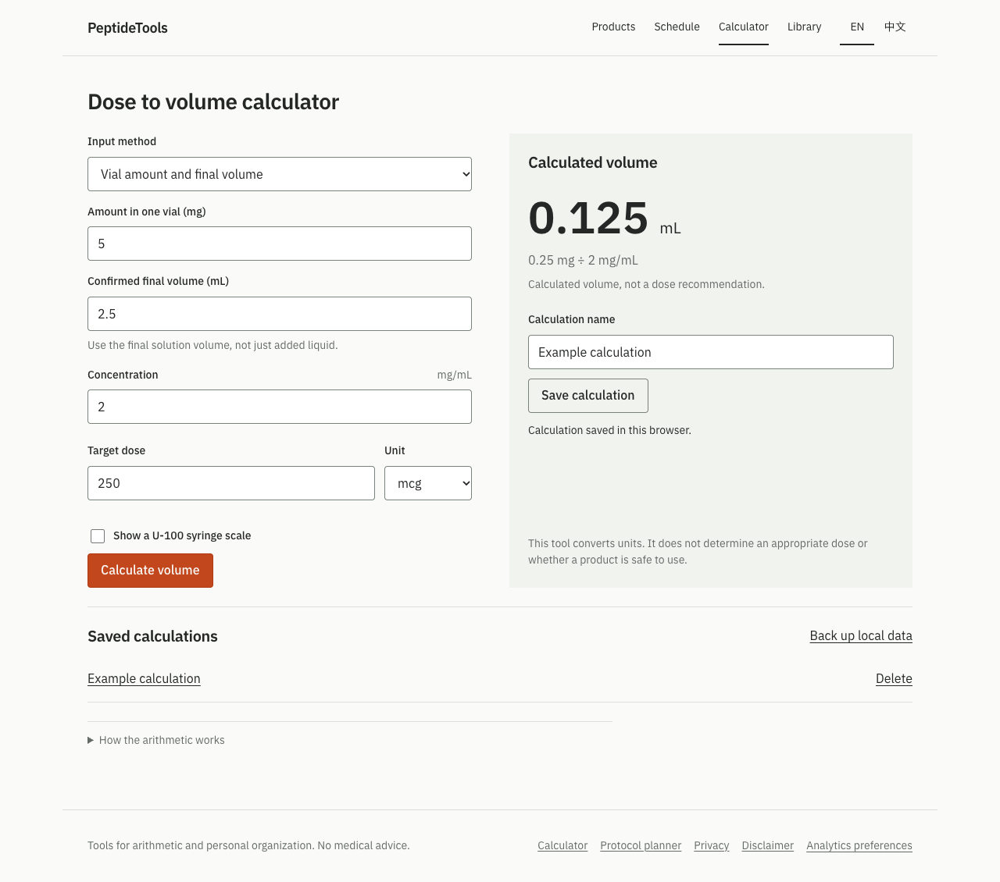
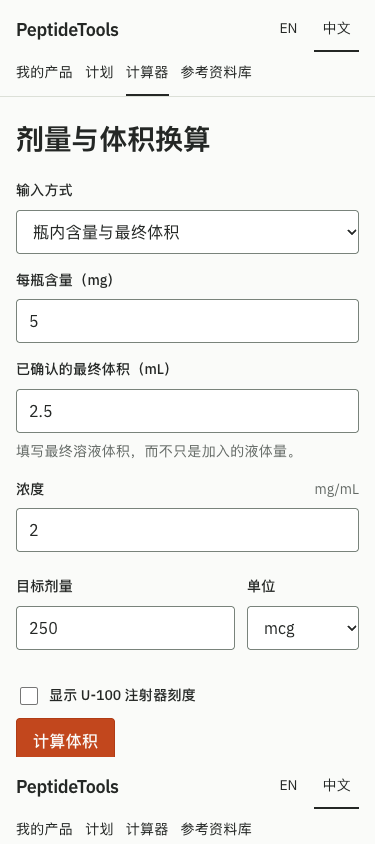
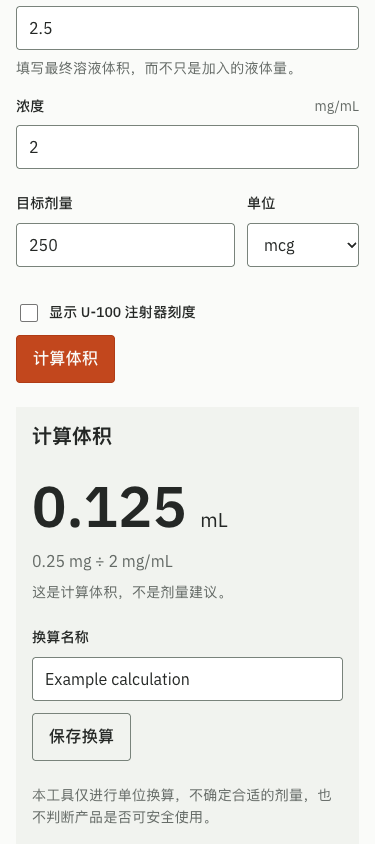
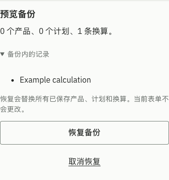

# Round-one label calculation workflow

2026-11-15 · branch `codex/label-calculation-workflow` · base `14a607c` (PR #12).

The owner approved a first round that joins label inputs to calculation, saves reusable setups, and makes local backup/restore explicit. The existing Hallmark app design is retained. Daily completion logs, reminders, inventory and outcome charts remain the separate second-round flow review.

## Delivered behavior

- Calculator: choose **Known concentration** or **Vial amount and final volume**. Label mode starts empty, computes concentration through the existing decimal core, and uses the same dose/volume/U-100 result and validation. Final solution volume is explicit; no amount, volume or product combination is recommended.
- Product label: the same source controller accepts final volume against the existing vial-amount field. Source changes clear concentration confirmation; deriving a number never checks either verification box. Unknown/incomplete records can still be saved unconfirmed.
- Save and reuse: successful calculations can be named and saved locally. Reopening restores inputs, never an automatically successful calculation. Linked product revisions require explicit review; revised blends additionally clear the old ingredient index. Repeated saves update one record. Missing/deleted products do not silently become standalone calculations.
- Data: product and planner backup controls share one implementation. A file is size/schema checked, then counts and optional record names are previewed. Cancel does not replace anything. Apply still asks for confirmation, validates again and only then replaces the envelope. The open planner form stays unchanged.
- Backup state: last download-request time and a local digest show whether records changed since the request. No statement claims the file was actually saved. Invalid metadata cannot prevent an otherwise valid export. Clearing all records also clears the optional metadata.
- English/Chinese source inputs and unsaved calculation name survive language switching. Native pickers, file selection, focus styles, mobile date/time containment, print/ICS behavior, source links and consent gating remain.

## UX / DX / AX

| Decision | UX | DX | AX |
|---|---|---|---|
| Two source modes | Start from the facts already known | One concentration controller and decimal core | Explicit units, native select, readonly derived field |
| Save named inputs | Avoid entering the same setup again | Central validated setup model and ID-based update | Stable local references, explicit reopen/save, no implicit calculation |
| Product revision check | No silent use of outdated label assumptions | Reuse existing product revision and validation | Visible confirmation state; changed blend basis must be chosen again |
| Shared backup controls | Preview before replacement, cancellable recovery | One validator/controller for both surfaces | Semantic preview and native buttons; names rendered as text |

## Data compatibility and rollback

The existing `peptide-tools.protocols.v1` key is retained. Reading does not migrate/write data. Versions 1 and 2 remain readable. New final-volume product sources (including plan snapshots) or saved calculations require **version 3**; old-only records still serialize in version 1/2. Limits remain 1 MB, 50 products, 20 schedules, and now 50 saved calculations. Unknown properties are discarded; malformed, duplicate, future-version and oversized backups fail before replacement. Product/planner mutations preserve saved calculations, and old plan snapshots remain independent of product edits.

A rollback to PR #12 cannot read version 3. It should reject those records without overwriting them, but they will not be accessible in its UI. Before rollback, download the version 3 backup. To regain access, deploy this version or another version-3-capable build; **do not clear storage or hand-edit the version number to downgrade it**. A code revert is not a lossless data downgrade. Retain the previous deployment as a code rollback option, with this data-access limitation visible.

## Verification

| Check | Observed result |
|---|---|
| Astro check | 58 files; 0 errors, warnings or hints |
| Unit tests | 35 passed, including repeating/tiny decimal cases, verification, v1/v2/v3 compatibility, atomic failed mutations and analytics filtering |
| Chrome / mobile WebKit | 80 passed; includes the original workflows and new source mode, reopen, changed product/blend, preview/cancel/restore, corrupted metadata and simulated-tag save/reuse checks |
| Build / static verification | 50 pages; local links/assets/metadata; 44 sitemap URLs |
| Responsive workflow | 14 EN/ZH cases at 320, 375, 390, 430, 768, 1280 and 1920px; no horizontal overflow or out-of-viewport visible controls |
| Hallmark app-scope rendered check | 25 captures across five routes; 0 FAIL / 0 REFLEX / 0 WARN; existing long-action-label heuristic dismissals remain documented |
| Screenshot review | Real calculated/saved states and restore preview inspected; static preview, no dev overlay, fictitious local data |

Existing restore tests were updated to click the newly required preview confirmation; they continue asserting the stored data and invalid-import preservation. New tests exercise meaningful data and workflow boundaries rather than snapshotting implementation details. Physical iPhone Safari and actual GA4 reception are not implied by WebKit or mocked-tag tests.

| Phone input | Phone result |
|---|---|
|  |  |

[Responsive measurements](evidence/label-workflow/checks.json).

## Analytics and release gate

The optional event contract adds `calculation_saved` and `calculation_reused`; calculation success/error accepts `input_mode=known|label`. Names, IDs, amounts, label/final-volume inputs, hashes, timestamps and digests are excluded. Refresh/restoration does not fabricate actions. Save/reuse tests verify event counts across same-page navigation using the existing bounded SDK callback helper.

New GA4 input-mode dimension/exploration and production receipt remain pending until an approved production release. This PR does not claim completed live instrumentation or change existing shared-property settings. See [event contract](../docs/analytics-product-journey.md).

Preview and PR review first; no merge, domain change or production release is included in this work.
