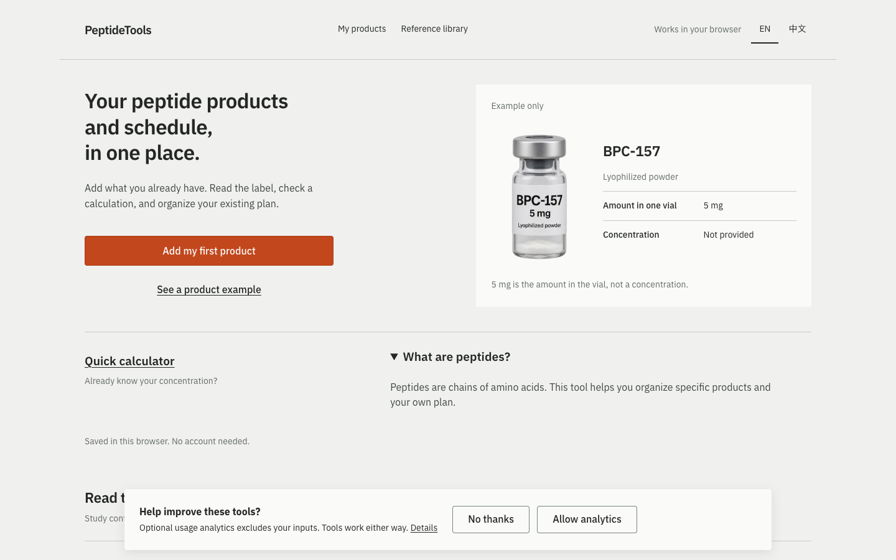
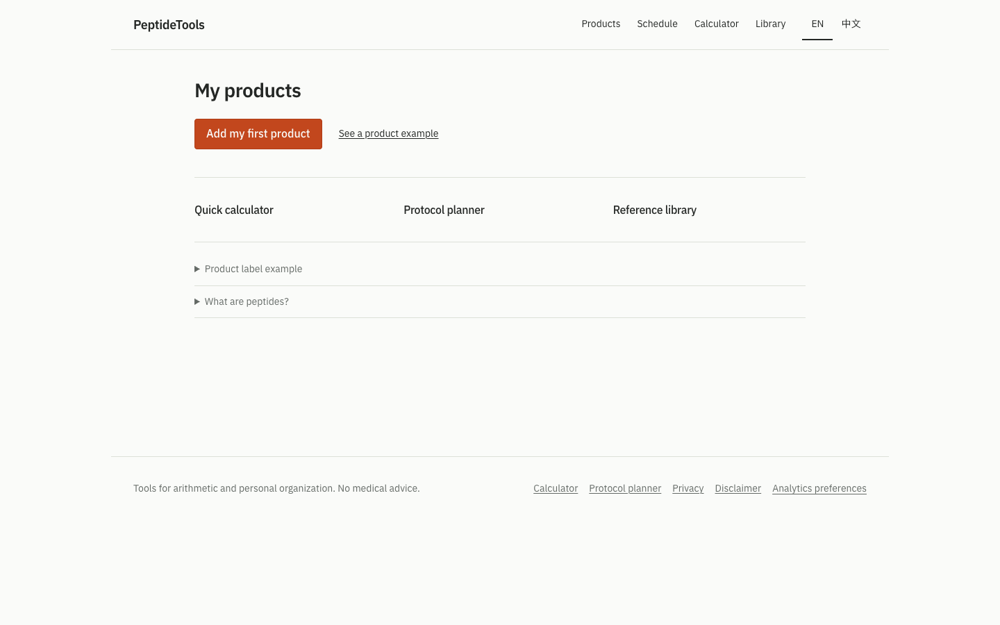
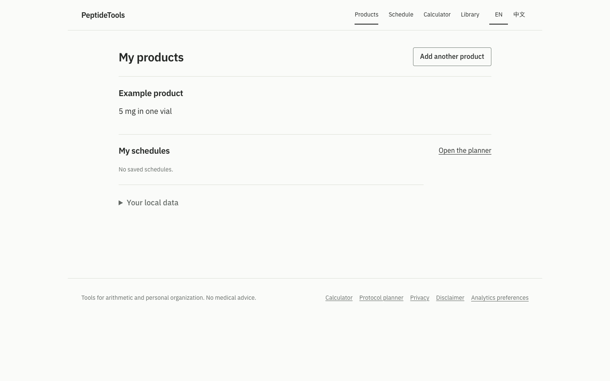
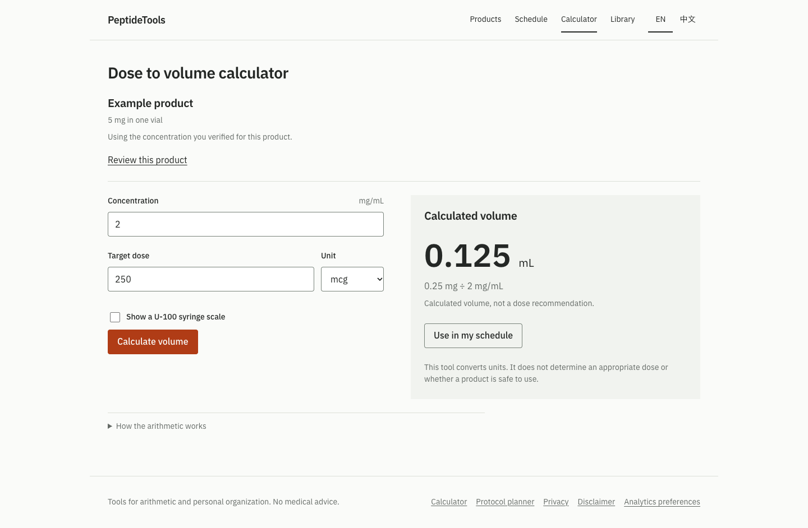
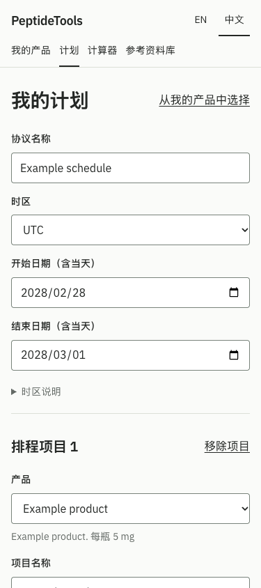
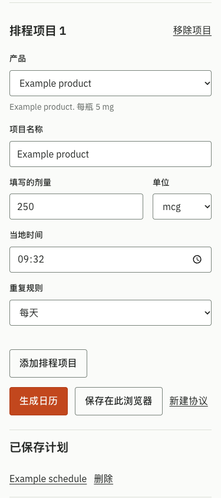
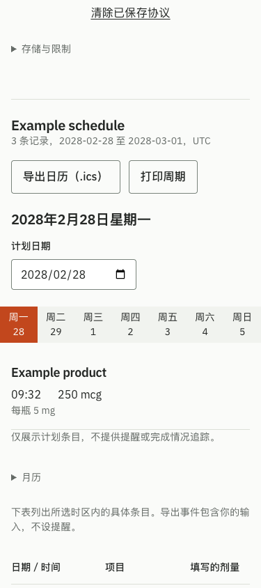
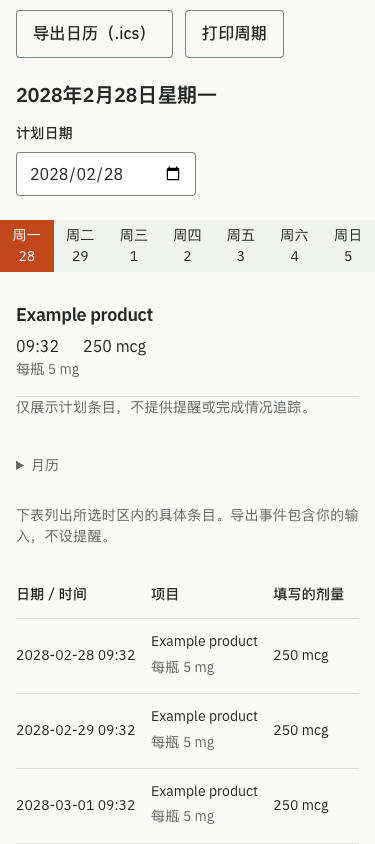

# Quiet workspace review

2026-11-15 · `codex/simplify-product-workspace` · base `7c6aae1` (PR #11).

The owner requested the restraint of Linear and Apple Notes: simple goals, architecture, design and implementation, with every decision improving UX, DX and AX. This changes presentation on the existing Astro app; no framework, dependency, storage schema or business service is introduced.

## Decisions

| Change | UX | DX | AX |
|---|---|---|---|
| Four direct task links | Products, schedule, calculator and library stay within reach | One shared navigation array | Native links, stable destinations and action enums |
| Short task titles and fewer labels | Less repetition around real inputs and records | Fewer duplicated strings/wrappers | Labels, units, IDs and explicit states retained |
| Native optional disclosures | Explanations remain available when needed | No custom disclosure state library | Semantic details/summary and described-by targets |
| Shared surfaces, scale and spacing | Clearer fields, values and results | Existing CSS tokens and components | Predictable landmarks and native controls |
| Agenda and exact entries first | Daily work precedes the larger month grid | Existing generation/render handlers | Same calendar IDs, controls and entries |

The home example and “What are peptides?” explanation now require opening a disclosure. This is a deliberate tradeoff for a quieter initial page. Unknown product states and calculation requirements remain explicit; an ineligible product's explanation opens automatically. Required confirmations, units, input errors and the calculation boundary remain visible. Reference limitations and supporting explanations are available on demand.

No routes, files or component trees were deleted. Arithmetic, recurrence/time zones, local-data mutation/backup/restore/clear handlers, exports, print semantics, analytics policy, legal content, consent copy, source facts, icons and bilingual metadata are unchanged. Render-only product/home code now makes product names actionable and uses the correct returning-user CTA. The existing CSS date/time containment and native file button treatment remain.

## Verification

| Check | Observed result |
|---|---|
| Astro check | 50 files, 0 errors/warnings/hints |
| Existing unit suite | 29 passed |
| Existing browser suite | 64 passed across Chrome and iPhone-profile WebKit; tests unchanged |
| Static build and verification | 50 pages, local assets/links/metadata, 44 sitemap URLs |
| Populated workflow | Example product: save unknown → edit verified label → calculate → carry amount into schedule → save/generate, including leap day and EN→ZH navigation |
| Responsive checks | EN/ZH at 320, 375, 390, 430, 768, 1280 and 1920px; no field overflow, horizontal page overflow, time/repeat overlap or page errors |
| Hallmark rendered sweep | 35 captures across seven routes; 0 FAIL, 0 REFLEX, 1 kept-figure warning |
| Independent finish review | `ship`; no actionable defects after correcting phone screenshot evidence |

The retention check preserved 57/57 links. Its twelve apparent field differences are per-visit planner/ingredient UUIDs; data hooks and handlers remain, exercised by the unchanged browser suite. One apparent test-hook difference is the old navigation conditional replaced by the navigation array using the same action. Fourteen removed/reworded headings follow the owner's copy cuts and are recorded in the CSS stamp. The remaining figure warning comes from “1,000” and “366 days” moving into disclosures: both facts remain in source and rendered DOM. This is not an unqualified zero-warning claim.

The first phone long-page screenshot had a stitching defect. It was replaced with ordinary viewport segments, inspected and independently reviewed. Final evidence uses the static preview without Astro's developer toolbar; the historical before image can show development tooling.

Reproduce after `npm run build` and starting `npm run preview` on port 4321:

```sh
npm run check
npm test
npm run verify:site
npm run test:e2e
node scripts/review-quiet-workspace.mjs
```

The capture script launches an isolated Chrome context, uses fictitious data, declines analytics and writes ignored screenshots to `qa/screenshots/quiet-workspace`. It does not use an existing browser profile. [Responsive results](evidence/quiet-workspace/responsive-checks.json) are retained with the review evidence.

Physical iPhone Safari was not tested in this run. Automated WebKit is browser evidence, not a real-device claim. Analytics tests inspect intercepted events and privacy boundaries; they do not claim production GA4 receipt for an unreleased branch.

## Visual evidence

| Before | After |
|---|---|
|  |  |





| Phone form | Date/time and repeat | Day agenda | Exact entries |
|---|---|---|---|
|  |  |  |  |

## Release and rollback

This branch is for PR and preview review; it does not authorize merging or a production release. If later released, revert this PR or promote the preceding Vercel production deployment after owner approval. This presentation-only change uses the same data schemas as its base, so rollback requires no migration. Download a JSON backup before any manual local-data operation; do not clear existing records as part of rollback.
